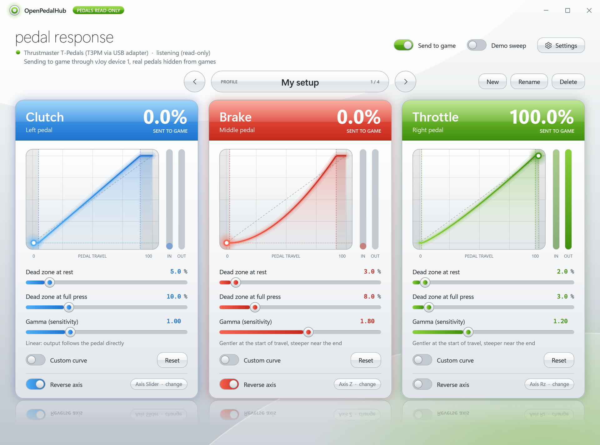
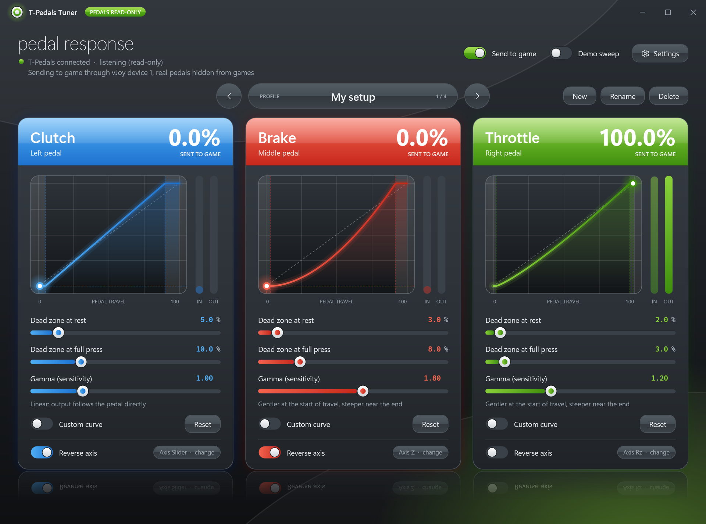
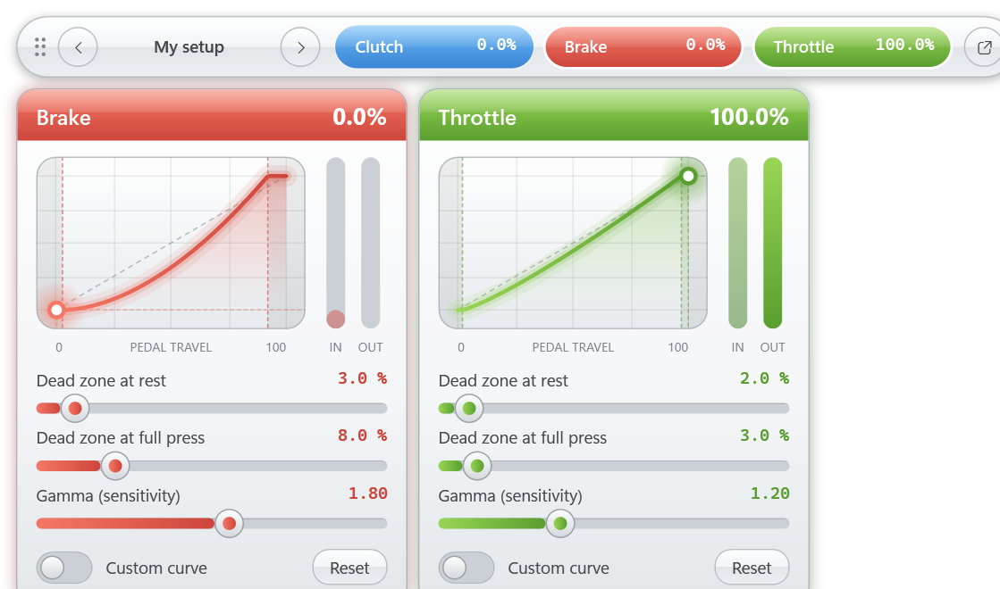

# OpenPedalHub

A free, community-driven hub for tuning sim-racing pedals on Windows.

Many pedal sets ship with software that cannot set dead zones or change the response curve, or with no software
at all. OpenPedalHub reads your pedals, reshapes each one the way you want, and hands the result to your game
through a virtual controller.



## What it does

- **Dead zones** at rest and at full press, to 0.1 %.
- **Gamma (sensitivity)** to 0.01, or a **custom curve** you shape by dragging points on the graph.
- **Calibration** that measures where each pedal really rests and bottoms out.
- **Named profiles** per game or car, switched with a sliding selector or the arrow keys.
- **In-game overlay**: a slim always-on-top bar with a tab per pedal that opens a small tuning panel.
- **Live graphs** showing pedal travel and the value sent to the game.
- **Default and Dark themes**, tray icon, and start with Windows.

| Dark theme | Game overlay |
|---|---|
|  |  |

## Is it safe for my pedals?

OpenPedalHub **only listens**. It receives the same position reports Windows already gets from the pedals, the
way a game does. It never opens the device for writing, sends nothing to it, and cannot touch firmware or
on-device calibration. All curves are applied on the PC. Close the app and your pedals behave exactly as before.

## Supported pedal sets

| Pedal set | Status |
|---|---|
| Thrustmaster T-Pedals (T3PM via USB adapter) | Tested |

Anything else can be taught to the app in about a minute. See [Adding a pedal set](#adding-a-pedal-set).

## What you need

- Windows 10 or 11, 64-bit.
- The [.NET 9 Desktop Runtime](https://dotnet.microsoft.com/download/dotnet/9.0).
- [vJoy](https://github.com/BrunnerInnovation/vJoy/releases): the virtual controller your game reads. Required to
  send anything to a game.
- [HidHide](https://github.com/nefarius/HidHide/releases) (optional): hides the real pedals from the game so it
  sees one set instead of two.

OpenPedalHub does not include or install these. On first run it shows a **Game connection** checklist that
tells you what is missing, links to the official download pages, and can create the virtual pedals in vJoy
for you. You can reopen it from **Settings → Game connection check**.

## Using it

1. Install vJoy (and HidHide if you want it), following the Game connection checklist.
2. Start OpenPedalHub **before** your game.
3. In your game, recalibrate the pedals and choose the **vJoy** axes.
4. Tune away. Changes apply immediately and are saved automatically.

If a game still shows your real pedals after installing HidHide, unplug the pedals and plug them back in once.
Hiding only starts working on a device after it has been reconnected.

## Adding a pedal set

1. Plug the pedals in and choose **Settings → Set up a pedal set**.
2. Press each pedal when asked.
3. The set now works on your PC, and a report file is saved in `Documents\OpenPedalHub\reports`.
4. Open an issue or pull request with that file to have the set added for everyone.

Maintainers: see [OpenPedalHub/pedalsets/README.md](OpenPedalHub/pedalsets/README.md) for the file format and
what to check before accepting a report.

**Privacy:** a report contains hardware *model* details only: USB vendor/product ids, the model name, axis
layout and measured ranges, plus the models of other game controllers plugged in at the time. It contains no
serial numbers, no device instance paths, no computer or user name, and no file paths.

## Known limits

- **Exclusive fullscreen hides the overlay.** Run the game in borderless or windowed mode.
- **Pedals plugged into a wheel base** share the wheel's USB device, so they are never hidden from games.
  They still work, but the game sees both the real and the virtual pedals.
- **Hiding a pedal set also hides it from the maker's own software** while OpenPedalHub is sending to a game.
- **vJoy axes have 32,768 steps.** Pedals with finer resolution than that lose their last bit.
- **Throttle and brake combined on one axis** (some older sets) is not supported.

## Downloading a release

Get the latest zip from the [Releases page](https://github.com/jojodoesthings/OpenPedalHub/releases/latest),
unzip it anywhere, and run `OpenPedalHub.exe`.

Releases are not code-signed, so Windows SmartScreen will warn the first time you run one, and some antivirus
tools may flag it: the app reads controller input and starts a small hidden helper that unhides your pedals if
the app ever crashes. The full source is here to inspect, and you can build it yourself.

## Building from source

```
dotnet build OpenPedalHub/OpenPedalHub.csproj -c Release
```

Requires the .NET 9 SDK on Windows. The program is written to `OpenPedalHub/bin/Release/net9.0-windows`.
Release builds deliberately contain no debug file and no local paths.

## Contributing

Pedal-set reports, bug reports and pull requests are welcome. Please keep reports and logs free of anything
that identifies a person or a PC.

## Licence

Copyright (C) 2026 [@SOHCDSeries](https://twitter.com/SOHCDSeries) and OpenPedalHub contributors.

**Code:** GNU General Public License v3.0. See [LICENSE](LICENSE). You may use, study, change and share it; if
you distribute a changed version, you must share its source under the same licence.

**Sounds:** the audio files are original works by @SOHCDSeries and are **not** covered by the GPL.
All rights are reserved. See [SOUNDS-LICENSE.txt](SOUNDS-LICENSE.txt). The app works without them.

## Credits and disclaimers

OpenPedalHub relies on [vJoy](https://github.com/BrunnerInnovation/vJoy) and
[HidHide](https://github.com/nefarius/HidHide), which are separate projects by their own authors.

This is an independent community project. It is not affiliated with, endorsed by, or supported by Thrustmaster
or any other hardware or game company. Product names are used only to identify compatible hardware. The
software is provided without warranty of any kind.
